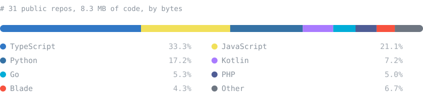

<!-- Generated by scripts/build-readme.mjs. Edit profile.config.json or the script, not this file. -->

```text
nmd@kroombox:~$ neofetch
    _   ____  _______          nmd@kroombox
   / | / /  |/  / __ \         ------------
  /  |/ / /|_/ / / / /         Role      SysAdmin & Web Developer
 / /|  / /  / / /_/ /          Study     D3 Information Systems, Telkom University
/_/ |_/_/  /_/_____/           Location  Indonesia
                               Uptime    4y 4m on GitHub
 +-------------------------+   Repos     31 public, 4 stars, 0 followers
 | :::::::::::  [##]   o o |   Languages TypeScript 33%, JavaScript 21%, Python 17%
 +-------------------------+   Commits   233 in the last 12 months, 378 contributions
 | :::::::::::  [##]   o o |   Streak    1 day now, best 7
 +-------------------------+   Last push sapawarga on 2026-10-16
                               Newest    sapawarga (2026-10-16)
```

I run Linux servers, NAS boxes and self-hosted services, and build the tools I wish I had while doing it. Most of what I make ends up open source: an SSH client for Android, a monitoring dashboard, and a small Postgres backend platform.

## `$ systemctl status --featured`

| Project | What it does | Stack | Status |
|:--|:--|:-:|:--|
| **[TermX](https://github.com/andiahmadnurmadani/TermX)** | SSH client for Android with persistent tmux sessions, auto-reconnect, SFTP and a live server monitor. | `Kotlin` | 🟢 active<br><sub>★ 2 · 2026‑10‑12</sub> |
| **[Kroombox Monitoring](https://github.com/andiahmadnurmadani/kroombox-monitoring)** | Self-hosted dashboard for websites, servers and NAS, with retries before alerts and one-click updates. | `TypeScript` | 🟢 active<br><sub>★ 0 · 2026‑10‑13</sub> |
| **[KroomBase](https://kroombase.kroombox.com)** | Postgres per project, a REST endpoint for every table, file storage and an MCP server for AI tools. | `TypeScript` | 🟢 live<br><sub>kroombase.kroombox.com</sub> |

## `$ ls -t ~/repos | head`

<sub>Picked up automatically from my latest pushes. A new repository shows up here on the next refresh.</sub>

| Repository | Description | Language | Last push |
|:--|:--|:-:|:-:|
| **[sapawarga](https://github.com/andiahmadnurmadani/sapawarga)** | PKM Hallowarga - web app (React/Vite + Node.js) | `TypeScript` | 2026‑10‑16 |
| **[printer-wireless](https://github.com/andiahmadnurmadani/printer-wireless)** | — | `JavaScript` | 2026‑10‑15 |
| **[RAG-JEV](https://github.com/andiahmadnurmadani/RAG-JEV)** | — | `Python` | 2026‑10‑11 |
| **[scm-bestari](https://github.com/andiahmadnurmadani/scm-bestari)** | — | `TypeScript` | 2026‑10‑06 |
| **[pos-app-migrations](https://github.com/andiahmadnurmadani/pos-app-migrations)** | Kroombase schema migrations for pos-app (database only, not application source) | — | 2026‑09‑23 |
| **[migration-kroombase](https://github.com/andiahmadnurmadani/migration-kroombase)** | — | — | 2026‑09‑13 |

## `$ du -sh --by-language`



## `$ git log --since=1.year`

<picture>
  <source media="(prefers-color-scheme: dark)" srcset="https://raw.githubusercontent.com/andiahmadnurmadani/andiahmadnurmadani/output/github-snake-dark.svg">
  
</picture>

| Contributions | Commits | Pull requests | Current streak | Longest streak | Busiest day | Favourite weekday |
|:-:|:-:|:-:|:-:|:-:|:-:|:-:|
| **378** | 233 | 1 | 1 day | 7 days | 2026-10-11 (33) | Thursday |

## `$ tail -f activity.log`

```text
2026-10-13 15:48  push     andiahmadnurmadani      1 commit to main
2026-10-13 15:47  push     kroombox-monitoring     1 commit to main
2026-10-13 15:35  push     andiahmadnurmadani      3 commits to main
2026-10-13 07:05  push     kroombox-monitoring     3 commits to main
2026-10-12 17:47  push     TermX                   4 commits to main
2026-10-12 06:01  public   TermX                   made public
2026-10-11 10:44  push     RAG-JEV                 1 commit to main
2026-10-10 23:55  push     RAG-JEV                 1 commit to main
```

## 💾 Disk Sweeper

Somewhere on this disk are **10 bad sectors**. Click a 🟦 sector to scan it: it opens an issue, press **Create**, and a GitHub Action plays your move and updates this page in about a minute. Numbers tell you how many bad sectors touch that one. Clear every clean sector to recover the disk.

<div align="center">

| | A | B | C | D | E | F | G | H |
|:-:|:-:|:-:|:-:|:-:|:-:|:-:|:-:|:-:|
| **1** | [🟦](https://github.com/andiahmadnurmadani/andiahmadnurmadani/issues/new?title=disk%7Creveal%7CA1&body=Press%20**Create**%20to%20scan%20A1.%20A%20bot%20plays%20it%20and%20closes%20this%20issue.) | 1️⃣ | ⬛ | ⬛ | ⬛ | 1️⃣ | [🟦](https://github.com/andiahmadnurmadani/andiahmadnurmadani/issues/new?title=disk%7Creveal%7CG1&body=Press%20**Create**%20to%20scan%20G1.%20A%20bot%20plays%20it%20and%20closes%20this%20issue.) | [🟦](https://github.com/andiahmadnurmadani/andiahmadnurmadani/issues/new?title=disk%7Creveal%7CH1&body=Press%20**Create**%20to%20scan%20H1.%20A%20bot%20plays%20it%20and%20closes%20this%20issue.) |
| **2** | 1️⃣ | 1️⃣ | ⬛ | ⬛ | ⬛ | 1️⃣ | 2️⃣ | [🟦](https://github.com/andiahmadnurmadani/andiahmadnurmadani/issues/new?title=disk%7Creveal%7CH2&body=Press%20**Create**%20to%20scan%20H2.%20A%20bot%20plays%20it%20and%20closes%20this%20issue.) |
| **3** | ⬛ | ⬛ | ⬛ | ⬛ | ⬛ | ⬛ | 2️⃣ | [🟦](https://github.com/andiahmadnurmadani/andiahmadnurmadani/issues/new?title=disk%7Creveal%7CH3&body=Press%20**Create**%20to%20scan%20H3.%20A%20bot%20plays%20it%20and%20closes%20this%20issue.) |
| **4** | ⬛ | ⬛ | ⬛ | ⬛ | 1️⃣ | 1️⃣ | 2️⃣ | [🟦](https://github.com/andiahmadnurmadani/andiahmadnurmadani/issues/new?title=disk%7Creveal%7CH4&body=Press%20**Create**%20to%20scan%20H4.%20A%20bot%20plays%20it%20and%20closes%20this%20issue.) |
| **5** | 1️⃣ | 1️⃣ | ⬛ | ⬛ | 1️⃣ | [🟦](https://github.com/andiahmadnurmadani/andiahmadnurmadani/issues/new?title=disk%7Creveal%7CF5&body=Press%20**Create**%20to%20scan%20F5.%20A%20bot%20plays%20it%20and%20closes%20this%20issue.) | [🟦](https://github.com/andiahmadnurmadani/andiahmadnurmadani/issues/new?title=disk%7Creveal%7CG5&body=Press%20**Create**%20to%20scan%20G5.%20A%20bot%20plays%20it%20and%20closes%20this%20issue.) | [🟦](https://github.com/andiahmadnurmadani/andiahmadnurmadani/issues/new?title=disk%7Creveal%7CH5&body=Press%20**Create**%20to%20scan%20H5.%20A%20bot%20plays%20it%20and%20closes%20this%20issue.) |
| **6** | [🟦](https://github.com/andiahmadnurmadani/andiahmadnurmadani/issues/new?title=disk%7Creveal%7CA6&body=Press%20**Create**%20to%20scan%20A6.%20A%20bot%20plays%20it%20and%20closes%20this%20issue.) | 2️⃣ | 1️⃣ | 1️⃣ | 2️⃣ | [🟦](https://github.com/andiahmadnurmadani/andiahmadnurmadani/issues/new?title=disk%7Creveal%7CF6&body=Press%20**Create**%20to%20scan%20F6.%20A%20bot%20plays%20it%20and%20closes%20this%20issue.) | [🟦](https://github.com/andiahmadnurmadani/andiahmadnurmadani/issues/new?title=disk%7Creveal%7CG6&body=Press%20**Create**%20to%20scan%20G6.%20A%20bot%20plays%20it%20and%20closes%20this%20issue.) | [🟦](https://github.com/andiahmadnurmadani/andiahmadnurmadani/issues/new?title=disk%7Creveal%7CH6&body=Press%20**Create**%20to%20scan%20H6.%20A%20bot%20plays%20it%20and%20closes%20this%20issue.) |
| **7** | [🟦](https://github.com/andiahmadnurmadani/andiahmadnurmadani/issues/new?title=disk%7Creveal%7CA7&body=Press%20**Create**%20to%20scan%20A7.%20A%20bot%20plays%20it%20and%20closes%20this%20issue.) | [🟦](https://github.com/andiahmadnurmadani/andiahmadnurmadani/issues/new?title=disk%7Creveal%7CB7&body=Press%20**Create**%20to%20scan%20B7.%20A%20bot%20plays%20it%20and%20closes%20this%20issue.) | [🟦](https://github.com/andiahmadnurmadani/andiahmadnurmadani/issues/new?title=disk%7Creveal%7CC7&body=Press%20**Create**%20to%20scan%20C7.%20A%20bot%20plays%20it%20and%20closes%20this%20issue.) | [🟦](https://github.com/andiahmadnurmadani/andiahmadnurmadani/issues/new?title=disk%7Creveal%7CD7&body=Press%20**Create**%20to%20scan%20D7.%20A%20bot%20plays%20it%20and%20closes%20this%20issue.) | [🟦](https://github.com/andiahmadnurmadani/andiahmadnurmadani/issues/new?title=disk%7Creveal%7CE7&body=Press%20**Create**%20to%20scan%20E7.%20A%20bot%20plays%20it%20and%20closes%20this%20issue.) | [🟦](https://github.com/andiahmadnurmadani/andiahmadnurmadani/issues/new?title=disk%7Creveal%7CF7&body=Press%20**Create**%20to%20scan%20F7.%20A%20bot%20plays%20it%20and%20closes%20this%20issue.) | [🟦](https://github.com/andiahmadnurmadani/andiahmadnurmadani/issues/new?title=disk%7Creveal%7CG7&body=Press%20**Create**%20to%20scan%20G7.%20A%20bot%20plays%20it%20and%20closes%20this%20issue.) | [🟦](https://github.com/andiahmadnurmadani/andiahmadnurmadani/issues/new?title=disk%7Creveal%7CH7&body=Press%20**Create**%20to%20scan%20H7.%20A%20bot%20plays%20it%20and%20closes%20this%20issue.) |
| **8** | [🟦](https://github.com/andiahmadnurmadani/andiahmadnurmadani/issues/new?title=disk%7Creveal%7CA8&body=Press%20**Create**%20to%20scan%20A8.%20A%20bot%20plays%20it%20and%20closes%20this%20issue.) | [🟦](https://github.com/andiahmadnurmadani/andiahmadnurmadani/issues/new?title=disk%7Creveal%7CB8&body=Press%20**Create**%20to%20scan%20B8.%20A%20bot%20plays%20it%20and%20closes%20this%20issue.) | [🟦](https://github.com/andiahmadnurmadani/andiahmadnurmadani/issues/new?title=disk%7Creveal%7CC8&body=Press%20**Create**%20to%20scan%20C8.%20A%20bot%20plays%20it%20and%20closes%20this%20issue.) | [🟦](https://github.com/andiahmadnurmadani/andiahmadnurmadani/issues/new?title=disk%7Creveal%7CD8&body=Press%20**Create**%20to%20scan%20D8.%20A%20bot%20plays%20it%20and%20closes%20this%20issue.) | [🟦](https://github.com/andiahmadnurmadani/andiahmadnurmadani/issues/new?title=disk%7Creveal%7CE8&body=Press%20**Create**%20to%20scan%20E8.%20A%20bot%20plays%20it%20and%20closes%20this%20issue.) | [🟦](https://github.com/andiahmadnurmadani/andiahmadnurmadani/issues/new?title=disk%7Creveal%7CF8&body=Press%20**Create**%20to%20scan%20F8.%20A%20bot%20plays%20it%20and%20closes%20this%20issue.) | [🟦](https://github.com/andiahmadnurmadani/andiahmadnurmadani/issues/new?title=disk%7Creveal%7CG8&body=Press%20**Create**%20to%20scan%20G8.%20A%20bot%20plays%20it%20and%20closes%20this%20issue.) | [🟦](https://github.com/andiahmadnurmadani/andiahmadnurmadani/issues/new?title=disk%7Creveal%7CH8&body=Press%20**Create**%20to%20scan%20H8.%20A%20bot%20plays%20it%20and%20closes%20this%20issue.) |

Scan in progress: 35 of 54 clean sectors found, 1 move by 1 player.

</div>

**Recent moves** &nbsp; `D4` ✅ [@andiahmadnurmadani](https://github.com/andiahmadnurmadani)

<sub>Games 1 · recovered 0 · lost 0 · moves 1 · most moves: @andiahmadnurmadani (1)</sub>

## `$ cat stack.txt`

                  

## `$ ping andi`

<a href="https://instagram.com/andi.nmd"></a> <a href="mailto:andiahmadnurmadani15@gmail.com"></a> <a href="https://kroombase.kroombox.com"></a>

---

<sub>Building systems, writing code, and keeping servers alive. &nbsp;·&nbsp; This README rebuilds itself every hour from the GitHub API (<a href="scripts/build-readme.mjs">scripts/build-readme.mjs</a>).</sub>

<sub>Last changed 2026-10-16 18:34 WIB.</sub>
